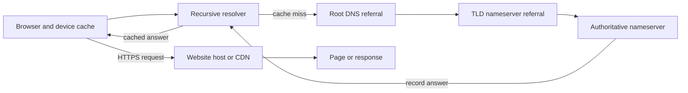

# Day 01 editorial pack — Domain Fundamentals

## A. Editorial brief

- **Audience:** Beginner readers worldwide: new website owners, entrepreneurs, developers, and people buying a first domain.
- **Reader problem:** The reader sees “domain,” “DNS,” “hosting,” “URL,” and “IP address” used interchangeably and needs to know which service does what before setting up a website.
- **Search intent:** Informational / beginner education (“what is a domain name,” “how do domains work,” and “domain vs URL / hosting”).
- **Unique angle:** Follow one fictional domain from the browser address bar through DNS and into a live web request, then connect that explanation to practical purchase and launch steps. The article explicitly separates registration, DNS, hosting, and website content.
- **Research requirements:** This draft was written from established technical knowledge. No live browsing or first-hand tests were available in the restricted authoring environment. Verify current registry/registrar rules, the reserved status of example names, and operational details against primary documentation before publication. The article avoids current pricing and fixed transfer/expiration timelines.

## B. SEO metadata

- **SEO title:** What Is a Domain Name? A Beginner’s Guide | DomainCraft
- **H1:** What Is a Domain Name? A Complete Beginner’s Guide to How Domains Work
- **Suggested slug:** `what-is-a-domain-name`
- **Published URL in this project:** `/blog/blog-03.html`
- **Meta description:** Learn what a domain name is, how DNS finds a website, and how domains differ from URLs, hosting, IP addresses, registrars, and registries.
- **Primary topic:** What a domain name is and how it works
- **Secondary topics:** Domain vs URL; domain vs hosting; DNS lookup; registrar vs registry; subdomain; domain-to-website setup
- **Target country:** Global
- **Target word range:** 1,800–2,400 words
- **Publication date:** October 23, 2026
- **First-hand material supplied:** None
- **Website/tool integration:** DomainCraft generator; it creates naming ideas only and is not an availability checker. The article links to `/tools/domain-generator.html` without implying that the tool checks registrations.

## C. Complete article

The complete Markdown article draft is [`day-01-article.md`](./day-01-article.md). Its static-site rendering is integrated in the archive at [`blog-03.html`](./blog-03.html), including the URL-parts comparison table, step-by-step DNS explanation, launch checklist, FAQ, original DNS SVG, and links to related DomainCraft resources. The HTML page includes BlogPosting and breadcrumb/navigation structured data. The current HTML article body is approximately 2,130 words; re-count after substantive editing.

## D. Visual production plan

### Featured image

- **Concept:** An original, clean technical illustration that separates a readable domain name from DNS, an IP address, and the website host. Use a simple browser-to-service flow; no fake dashboard or product screenshot.
- **Implemented cover:** `/assets/img/blog/feature-what-is-a-domain-name.jpg`, visible on the archive card and article page.
- **Ratio:** 16:9 (1200 × 675 pixels).
- **Alt text:** “A domain name is looked up through DNS before a browser connects to a website host.”
- **Image prompt:** “Create an original editorial vector illustration, 16:9 wide, for a beginner guide to domain names. Show a browser address bar containing the fictional reserved example `lumenbikes.example`, a simple DNS lookup path, and a separate website server. Make clear visually that the domain name, DNS service, hosting server, and webpage are different pieces. Restrained indigo and teal palette, clean shapes, generous whitespace, no brand logos, no copied interface, no tiny text, no price or market data.”

### In-article visuals

1. **URL breakdown table** — placed in “Domain name, URL, website and IP address.” It labels scheme, host, subdomain, registrable name, path, and query using one fictional example. It is an original HTML table, not copied from another publication.
2. **DNS lookup flow diagram** — placed in “How DNS finds the right service.” An original SVG is already included at `assets/img/domain-lookup-flow.svg`, with descriptive alt text and a caption. It shows the cache check, resolver referrals, authoritative answer, and subsequent web connection. It is explanatory, not measured data.
3. **Domain-to-site checklist** — presented as an ordered checklist in the article. No chart is needed; the steps are procedural rather than statistical.

### Mermaid source for the conceptual lookup flow

## E. Internal linking plan

- Existing: `/tools/domain-generator.html` — use for name brainstorming, with a clear note that it does not check availability.
- Existing: `/blog/blog-01.html` — name clarity and pre-registration checks.
- Existing: `/blog/blog-02.html` — choosing a domain extension.
- Future editorial opportunity: Day 02, “How DNS Works: From Typing a Domain Name to Loading a Website.”
- Future editorial opportunity: Day 04, “Domain Registration, Renewal, Expiration and Redemption.”

## F. Sources

**Sources actually consulted for this draft:** None were live-fetched in this environment. The article is based on established concepts, but a human editor should validate technical wording before publication. The links below are primary references recommended for that review; they are not represented as sources consulted during drafting:

- [RFC 1034 — Domain Names: Concepts and Facilities](https://www.rfc-editor.org/rfc/rfc1034) — DNS concepts and hierarchy.
- [RFC 1035 — Domain Names: Implementation and Specification](https://www.rfc-editor.org/rfc/rfc1035) — DNS message and resource-record foundations.
- [RFC 2606 — Reserved Top Level DNS Names](https://www.rfc-editor.org/rfc/rfc2606) — documentation-only example names.
- [IANA Root Zone Database](https://www.iana.org/domains/root/db) — delegated TLD information.

## G. Final editorial audit

- **Accuracy:** Core distinctions are stated without fixed prices or exact transfer/expiration deadlines. DNS answers can be cached, can include aliases, and can change; the article does not promise a single IP per domain.
- **Limitations:** No live source verification, product testing, or legal review was performed. The site itself still has `example.com` deployment placeholders elsewhere, so replace those before launch.
- **Originality review:** Written as a new explanation from the outline. No source text, sales data, case study, quote, or personal experience was copied or invented. No similarity checker was available; do not claim plagiarism-free status.
- **Visual review:** The SVG flow is explanatory and contains no invented data. Keep the diagram responsive and ensure its alt text remains meaningful.
- **Human editorial work before publish:** Verify all primary-source links and the reserved-example domain claim; review DNS terminology and current ICANN/registry policies; confirm the article's publication date and byline; check the production URL, canonical, schema, and internal links. Legal and trademark advice remains outside the scope of this guide.
